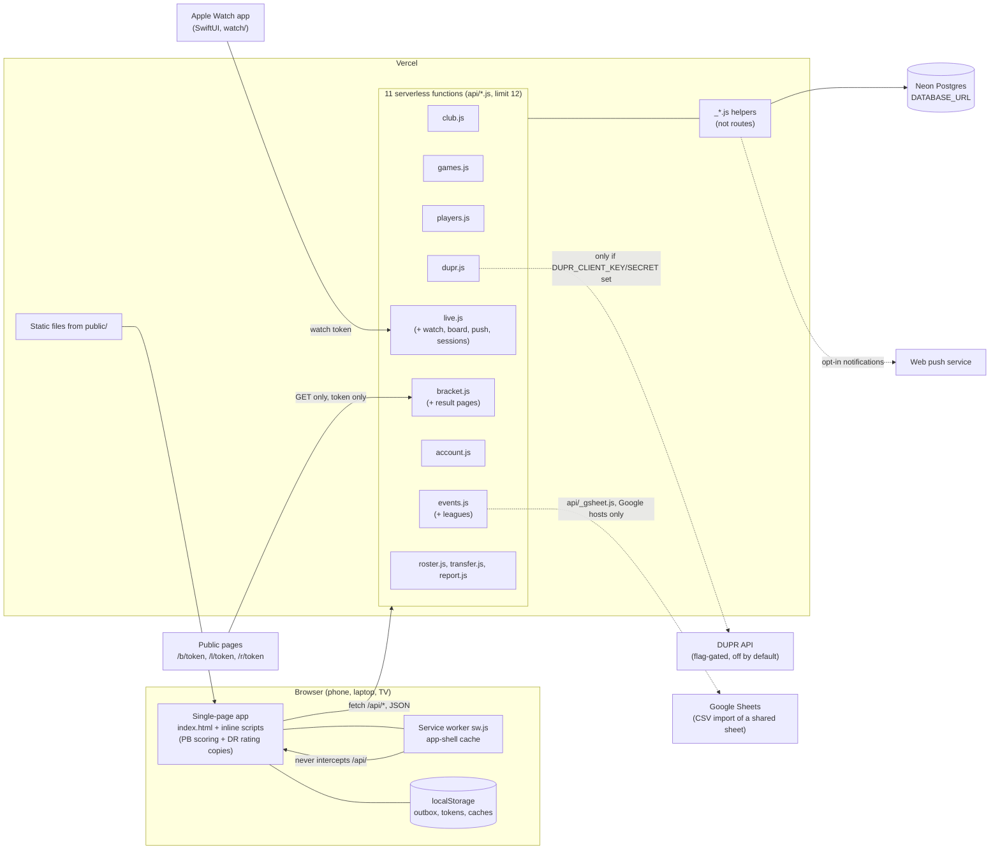
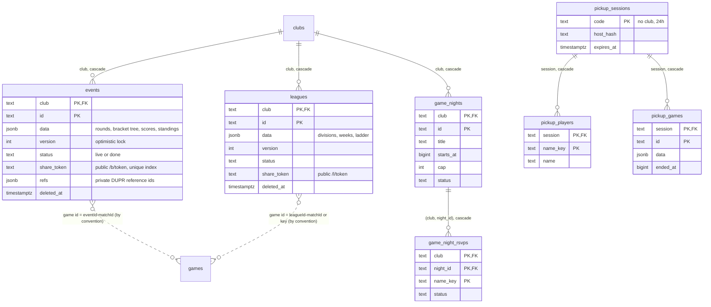
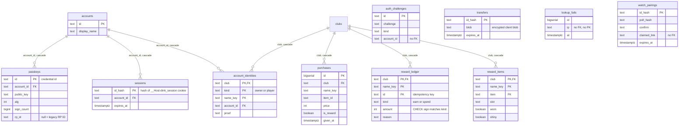
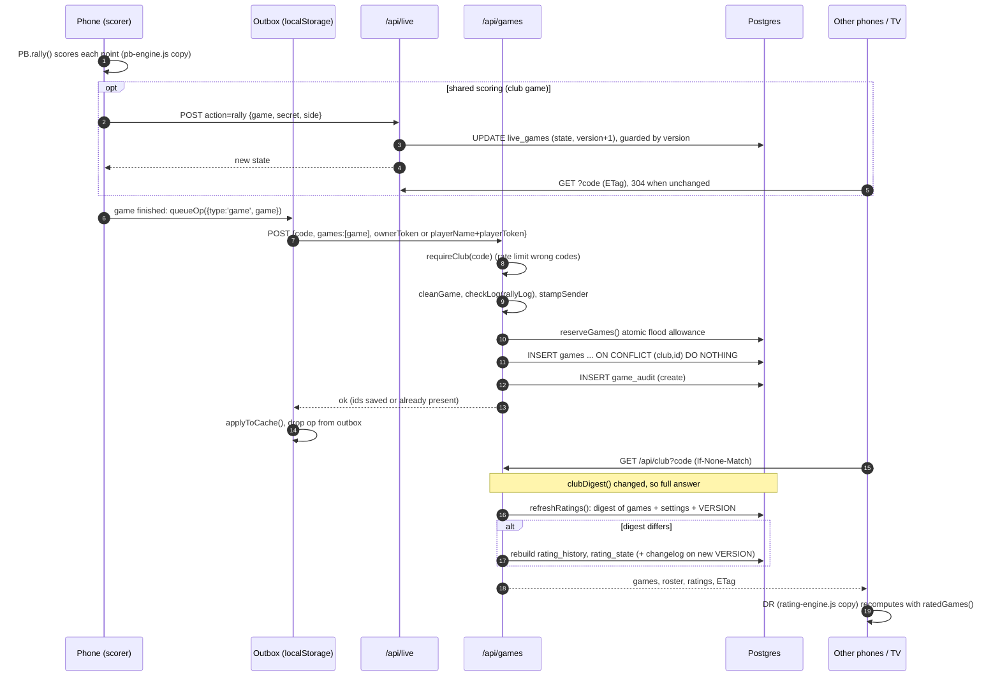
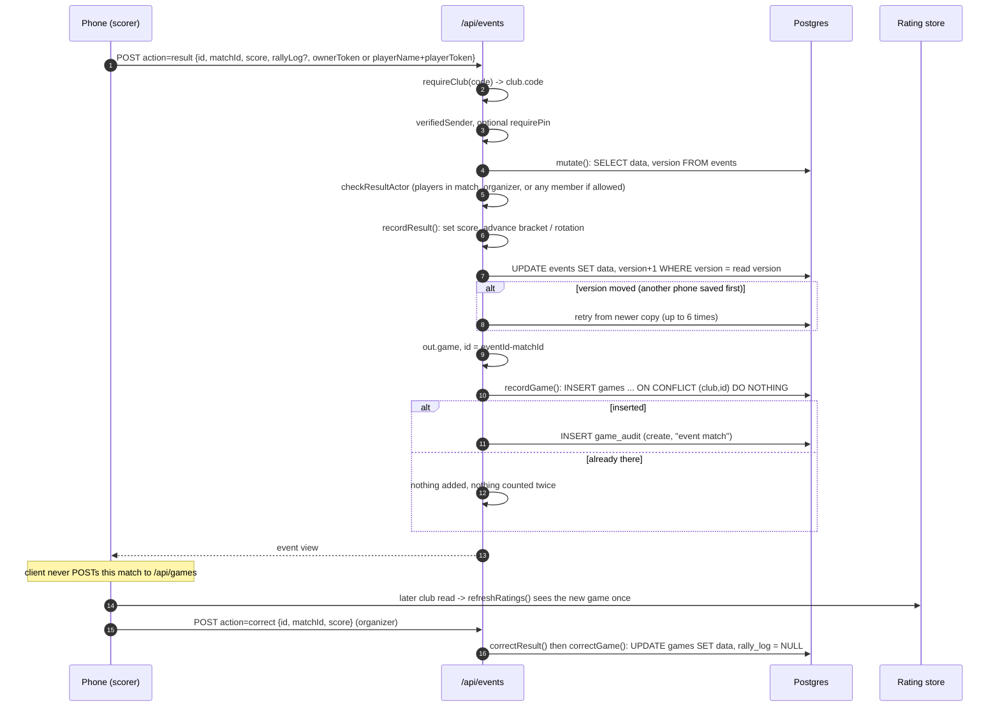
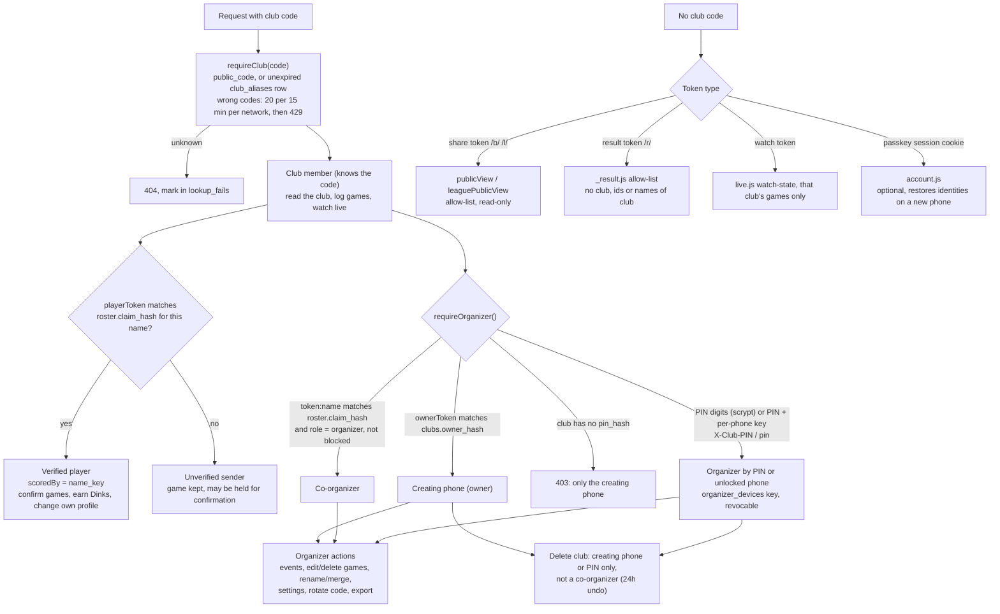
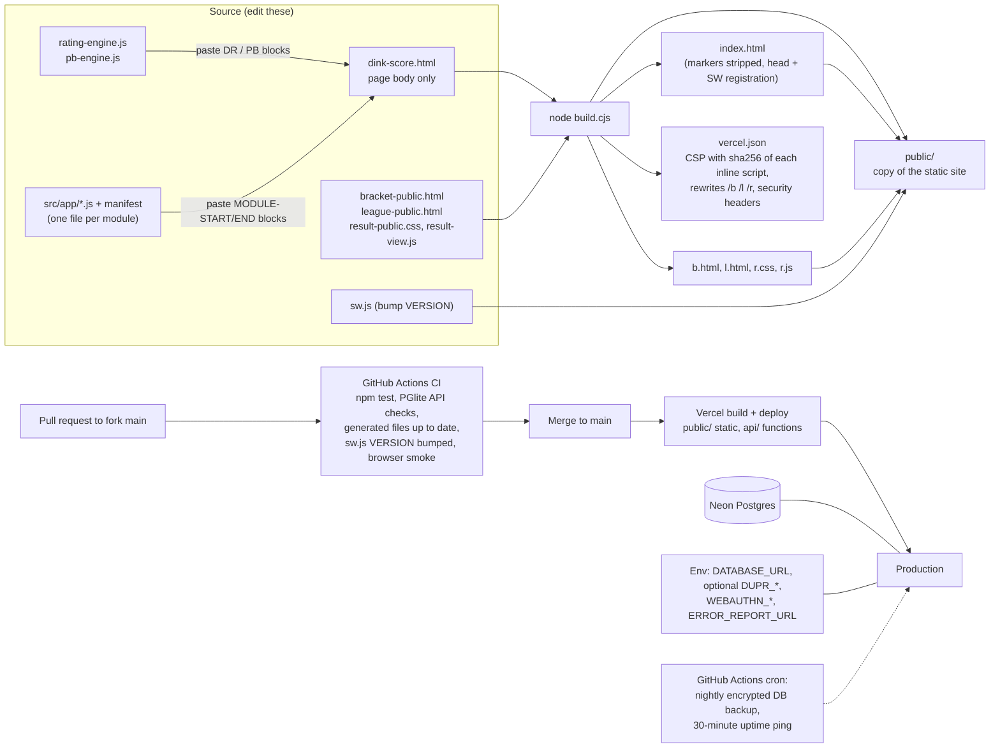

# Dink Score architecture

A technical overview for engineers new to the codebase. Everything here is derived from the code; the file named in each section is the authority, so when this page and the code disagree, the code wins. Project rules and sharp edges live in [`AGENTS.md`](../AGENTS.md). Every identifier in this document (club codes, PINs, tokens, URLs) is a made-up placeholder.

Contents: [1. System context](#1-system-context) | [2. Data model](#2-data-model) | [3. Logging a game](#3-logging-a-game-to-a-rating-update-and-sync) | [4. Event matches](#4-an-event-match-reaching-the-club-record-once) | [5. Auth and permissions](#5-auth-and-permissions) | [6. Build and deploy](#6-build-and-deploy) | [7. Other subsystems](#7-other-subsystems) | [8. Where to look](#8-where-to-look)

## 1. System context

How it fits together:

- **There is no server-rendered app.** The whole UI is one static HTML file with inline scripts (section 6). The server is a JSON API over Postgres. Only the public result page (`/r/<token>`) is rendered by a function.
- **The server is the source of truth, the phone is a working copy.** Writes go through an outbox in `localStorage` (`pb.outbox`, `src/app/club-sync.js`) and are retried, so scoring works with no signal. Club data is polled, with ETag/304 so a quiet poll moves almost no data (`api/_sync.js`, "Sync v2").
- **The service worker never touches `/api/`, `/_vercel/`, `/b/`, `/r/`, `/privacy` or `/terms`** (`sw.js` fetch handler). Club data is always live; public pages are never replaced by the app shell.
- **Twelve functions is a hard hosting limit.** Every `api/*.js` not starting with `_` is a function; `test/functions.test.js` fails at more than 12. There are 11 today. New routes are folded into an existing function by action name and implemented in a `_*.js` helper:

  | Function | Also serves (folded in) |
  | --- | --- |
  | `club.js` | seasons (`_seasons.js`), club links (`_clublinks.js`), game nights (`_gamenights.js`), organizer devices (`_devices.js`), public result admin `results-*` (`_resultsadmin.js`), analytics (`_analytics.js`), data export and club deletion |
  | `events.js` | leagues and ladders (`_leagues.js` and friends, `league-*` actions, `?leagues=1`, `?league=<id>`), seeding, Google Sheet fetch |
  | `live.js` | Apple Watch linking and scoring (`_watch.js`), open-play court board (`_courtboard.js`, `board-*`), push subscriptions (`_push.js`), pickup sessions (`_sessions.js`, `session-*`) |
  | `players.js` | rename/merge (`_rename.js`), data rights (`export`, `anonymise`), rewards economy (`rewards-*`, `_economy*.js`), organizer approvals (`_approvals.js`), paddles |
  | `bracket.js` | shared league page (`?league=`) and public result pages (`?result=1`, `_resultpublic.js`) |
  | `games.js`, `account.js`, `dupr.js`, `roster.js`, `transfer.js`, `report.js` | their own routes only |

  `handler()` in `api/_db.js` wraps every function: it runs `ensureSchema()`, then the route, and turns thrown `fail(status, message)` errors into JSON. A 500 is reported through `_report.js` and the user sees a generic message.

## 2. Data model

The schema is created lazily by `ensureSchema()` in `api/_db.js` on the first request of each function instance. All statements are `CREATE TABLE IF NOT EXISTS` / `ADD COLUMN IF NOT EXISTS`, so schema changes are additive and re-runnable. The DUPR tables are created separately by `ensureDuprSchema()` in `api/_dupr_store.js`. Only keys and the most informative columns are drawn; `api/_db.js` has the full lists.

Two invariants hold everywhere:

1. **`clubs.code` is the permanent key.** The code people type is `clubs.public_code` (or, for a never-rotated club, `code` itself) or an unexpired row in `club_aliases`. `requireClub()` resolves any of these to the row, and handlers must query with `club.code`, never with the code from the request.
2. **Every per-club table cascades from `clubs`.** Deleting a club (after its 24-hour undo window) removes everything with one `DELETE`. A new per-club table must `REFERENCES clubs(code) ON DELETE CASCADE` or be added to the data-rights check (`tools/rights-check.mjs`).

### 2a. Clubs, players and games

```mermaid
erDiagram
  clubs ||--o{ games : "club, cascade"
  clubs ||--o{ roster : "club, cascade"
  clubs ||--o{ club_aliases : "club, cascade"
  clubs ||--o{ name_changes : "club, cascade"
  clubs ||--o{ game_audit : "club, cascade"
  clubs ||--o{ club_audit : "club, cascade"
  clubs ||--o{ club_seasons : "club, cascade"
  clubs ||--o{ live_games : "club, cascade"
  clubs ||--o| court_boards : "club, cascade"
  clubs ||--o| rating_state : "club, cascade"
  clubs ||--o{ rating_history : "club, cascade"
  clubs ||--o{ rating_changelog : "club, cascade"
  clubs ||--o{ result_shares : "club, cascade"
  clubs ||--o{ organizer_devices : "club, cascade"
  clubs ||--o{ approval_requests : "club, cascade"
  clubs ||--o{ push_subs : "club, cascade"
  clubs ||--o{ watch_links : "club, cascade"
  clubs ||--o{ watch_offers : "club, cascade"
  clubs ||--o{ club_links : "club_a / club_b, cascade"
  games ||--o{ game_reactions : "(club, game_id), cascade"
  games ||--o| dupr_matches : "club cascade, game_id is unenforced"

  clubs {
    text code PK "permanent key"
    text name
    text public_code "rotated code people type"
    text pin_hash "scrypt, organizer PIN"
    text owner_hash "scrypt, creating phone token"
    text recovery_hash
    boolean quick "throwaway game room"
    boolean require_confirmation
    boolean rewards
    boolean mystery_box
    boolean public_results
    timestamptz delete_at "24h undo window"
    jsonb shop
    text pay_link
    text pinned_note
  }
  games {
    text club PK, FK
    text id PK
    jsonb data "the game, allow-listed by cleanGame"
    bigint ended_at
    text rally_log "winners per rally, see _rallylog.js"
    text confirmed_by
    timestamptz confirmed_at
    boolean dup_ok
    timestamptz deleted_at "soft delete, 30 days"
  }
  roster {
    text club PK, FK
    text name_key PK "nameKey(): trimmed, NFC, lower case"
    text name
    text claim_hash "phone player token, hashed"
    text role "organizer or null"
    timestamptz blocked_at
    numeric dupr_rating "self-reported, display only"
    jsonb avatar
    jsonb equipped
    jsonb paddles
    boolean rewards_public
  }
  game_audit {
    bigserial id PK
    text club FK
    text game
    text action
    text actor
    jsonb before
    jsonb after
  }
  club_audit {
    bigserial id PK
    text club FK
    text actor
    text action
    jsonb detail
    timestamptz undone_at
  }
  club_aliases {
    text code PK "retired code"
    text club FK
    timestamptz expires_at
  }
  name_changes {
    text club PK, FK
    text old_key PK
    text new_name
  }
  club_seasons {
    text club PK, FK
    bigint starts_at PK
    text name
  }
  live_games {
    text club PK, FK
    text id PK
    jsonb state
    jsonb intents
    text secret_hash
    int version
    jsonb stack
    jsonb ops
  }
  court_boards {
    text club PK, FK
    jsonb data
    int version
  }
  rating_state {
    text club PK, FK
    int version
    text digest
  }
  rating_history {
    text club PK, FK
    text mode PK
    text pkey PK
    int n PK
    text game_id
    float8 rating
  }
  rating_changelog {
    text club PK, FK
    int version PK
    jsonb moves
  }
  result_shares {
    text token PK
    text club FK
    text kind
    text game
  }
  game_reactions {
    text club PK, FK
    text game_id PK, FK
    text name_key PK
    text reaction PK
  }
  dupr_matches {
    text club PK, FK
    text game_id PK
    text identifier UK
    text status
    int revision
  }
  club_links {
    text id PK
    text club_a FK
    text club_b FK
    text invite
  }
  organizer_devices {
    text club PK, FK
    text id PK
    text key_hash
    text name_key
  }
  approval_requests {
    text club PK, FK
    text id PK
    text name_key
    text token_hash
    text status
  }
  push_subs {
    text club PK, FK
    text endpoint PK
    text name_key
  }
  watch_links {
    text id PK
    text club FK
    text token_hash UK
    text game_id
  }
  watch_offers {
    text id_hash PK
    text club FK
    text game_id
  }
```

Non-obvious points:

- **A game is a JSON document plus a few server-owned columns.** `games.data` holds only what `cleanGame()` (`api/_db.js`) lets through; server facts such as `scoredBy`, `scoredByPlayer` and `receivedAt` are stamped by the server (`stampSender`) and cannot be set by a phone. `games.id` is chosen by the client, and `PRIMARY KEY (club, id)` plus `INSERT ... ON CONFLICT DO NOTHING` makes every save idempotent. This is the foundation of the "no double counting" guarantee.
- **Soft delete.** `games.deleted_at` hides a game for 30 days (restorable); every read filters `deleted_at IS NULL`.
- **`roster` is the player identity.** A player is `(club, name_key)`; there is no separate player table. `claim_hash` is the hash of the token on the phone that claimed the name. Player names stored elsewhere (games JSON, events, boards, ledger rows) are by name, so rename/merge (`_rename.js`) rewrites each place in one transaction and records a `name_changes` row that phones follow.
- **Rating tables are derived, not authoritative.** `rating_history`, `rating_state` and `rating_changelog` are rebuilt from `games` by `refreshRatings()` whenever the game set, the confirmation setting or the engine `VERSION` changes (detected by a digest). They can be dropped and rebuilt safely.
- **`dupr_matches.game_id` has no foreign key to `games`.** Its only FK is `club` to `clubs`. The link to a game (or event match) is by convention.
- **`live_games` has two counters.** `version` is the optimistic-concurrency counter that shared scoring checks (`live.js`); `seq` is the original column from the first version of the table. `clubs.total_count` and `roster.prestige` are marked unused/legacy in the code.

### 2b. Events, leagues, brackets and calendar

> Pickup sessions are club-less: `pickup_sessions` has no `club` column and is not connected to `clubs`.

Non-obvious points:

- **An event or league is one JSON document**, not rows per match. `data` holds rounds, the bracket tree, courts, scores and standings; the pure logic is in `_events.js`, `_rotation.js`, `_schedule.js`, `_bracket.js`, `_seeding.js` and the `_league*.js` files (no database, covered by `npm test` with no install).
- **`events.version` is an optimistic lock.** `mutate()` in `api/events.js` reads, applies a change, and `UPDATE ... WHERE version = <read version>`, retrying up to 6 times. Two phones finishing different matches at the same moment both succeed.
- **Brackets have no tables of their own.** The tree lives in `events.data.tree`; `_bracket.js` computes where winners and losers go.
- **Share tokens are separate from club codes.** `events.share_token` / `leagues.share_token` are unguessable and give read-only access to one document through an allow-list (section 5). The `events_share_token` and `leagues_share_token` indexes make the lookup cheap.
- **Pickup sessions are the only club-less feature**: 8-character codes, 24-hour expiry (`expires_at`), no organizer, cascade from `pickup_sessions`.

### 2c. Accounts, economy, audit and watch/transfer

Non-obvious points:

- **Accounts are optional and isolated.** `accounts`, `passkeys`, `sessions`, `auth_challenges` and `account_identities` are the only tables that know about accounts. No-login code paths never read them; `account_identities` is the bridge, linking an account to a club identity (`kind` `owner` or `player`) that the phone could already prove. It stores a `proof` (a hash), not the phone's token.
- **`reward_ledger` is append-only and checked by the database.** `kind IN ('earn','spend')` and an `amount` whose sign matches `kind` are `CHECK` constraints; the balance is only ever the sum. `id` is unique per player per club, so replays and second devices add nothing twice. Earnings are derived on the server from games a player's own verified phone saved and the server's own `receivedAt` clock, so a phone cannot claim or backdate Dinks (`api/_economy.js`). The economy is play money: nothing converts to anything and nothing in it reads or changes a score, rating or pairing. `purchases` is the older shop/reward-fulfilment record (`is_reward`, `given_at`); `reward_items` is what a player owns and wears.
- **Tables with no foreign key by design:** `lookup_fails` (wrong-code and PIN rate-limit marks per network address, swept probabilistically in `purgeMarks`), `transfers` (short-lived encrypted phone-to-phone blobs), `watch_pairings` (a watch pairs before it has a club), `auth_challenges`. All of these expire and carry no club data.
- **Audit is append-only.** `game_audit` records create, edit, delete, restore, confirm and keep-both with before/after snapshots (`api/_audit.js`); `club_audit` records organizer-level actions (`api/_members.js`). Anonymising a player relabels their name in both, so audit does not keep a name that was erased.

## 3. Logging a game to a rating update and sync

Non-obvious points:

- **Two rating computations, one engine.** `rating-engine.js` is the single source. The server imports it through `api/_rating.js` (a one-line re-export); `build.cjs` pastes the same code into the page as the `DR` block, which the app runs. `test/rating.test.js` pins both to the same numbers. Same story for scoring: `pb-engine.js`, imported through `api/_pb.js` and pasted as the `PB` block. The Swift watch app cannot share code, so it is pinned by golden vectors (`tools/pb-vectors.mjs`).
- **Ratings are always rebuilt from the full game list**, not the 2000 newest games the club answer carries, so a long-lived club's ratings do not drift with the page size. Only the newest `HISTORY_KEEP` (200) points per player and mode are stored. On the first rebuild after the engine `VERSION` changes a `rating_changelog` row records each player's old and new rating. Rename and anonymise call `dropRatings` so no old name survives.
- **The model:** scale 2.00 to 8.00, new players 2.00, doubles and singles rated separately, expected score share `1 / (1 + 10^(-gap/2.8))`, change `K x (actual share - expected share)`, actual share capped at 11-3, `K` shrinking with reliability, Provisional under 10 games (`rating-engine.js`).
- **Confirmation holds a game out of ratings.** When `clubs.require_confirmation` is on, an unconfirmed game is marked `hold` and `ratedGames()` (`src/app/app-state.js`) and `_confirm.js` `counts()` skip it. The creating phone's games are stored `confirmed_by = 'organizer'`; everyone else's wait for a player on the other team or an organizer (`POST /api/games {confirm}`).
- **Idempotent by id.** The client chooses `games.id`; resending after a dropped response inserts nothing and does not count twice. The live game id and the saved game id are the same, so a watch-finished game saved by the server (`saveLiveGame` in `_gamesave.js`) and the phone's own save collapse into one row.
- **Flood protection** is `reserveGames()`: at most 1,200 new games per club per 10-minute window, 20,000 undeleted and 40,000 stored rows including deleted ones, taken atomically under a row lock on `clubs`.
- **A bad rally log never loses a game.** `checkLog` replays the log with the server's copy of the rules (`_rallylog.js`); a log that does not reproduce the score is dropped, the game is saved, and its id is returned in `rejectedLogs`.

## 4. An event match reaching the club record once

Non-obvious points:

- **One door.** Event and league matches reach the club record only through `api/events.js` (`recordGame` in `_gamesave.js`), with the game id `<eventId>-<matchId>` (leagues: `<leagueId>-<matchId or key>`). The client never saves an event match as a normal game. Because the id is derived, not random, repeating the request, a retry after a timeout, or two phones submitting the same match all hit `ON CONFLICT DO NOTHING`.
- **Event first, then game.** The event document is updated under its version lock, and only then is the game inserted. If the process dies between the two, a retry re-runs `recordResult`/`recordGame` and the unique key makes the second step safe.
- **Event matches skip separate confirmation.** The event's organizer controls who may enter results (`results-by`), so `recordGame` does not hold them; an organizer's own entry is stored as confirmed.
- **Corrections edit in place.** `correctGame` keeps the same id, merges the new data, clears `rally_log` (an event score correction invalidates a replay) and writes an `edit` audit row. It does nothing if the game was deleted from the record.
- **DUPR never goes through here.** Event matches are exported to DUPR from `api/dupr.js` and never write to `games`, so a DUPR send cannot double count in app ratings (section 7).

## 5. Auth and permissions

There are no passwords and, for most people, no accounts. Authority comes from what a request can prove.

Non-obvious points:

- **The phone token.** A player claims a name (`players.js` `claim`); the phone invents or receives a 48-hex token, the server stores only its scrypt hash in `roster.claim_hash`, and `tokenMatches` compares in constant time. The name key a request proves is never read from the game's own data; `verifiedSender`/`stampSender` in `api/_db.js` stamp `scoredBy` server-side. Achievements, seasons and Dinks count only games with a verified `scoredBy`.
- **Club code is a low-grade secret, the PIN and tokens are the real ones.** The code gives membership. It can be rotated (`rotate-code`): the old code keeps working through a grace period via `club_aliases` (default 60 minutes, at most 1,440).
- **Organizer rules** (`requireOrganizer` in `api/_db.js`): the creating phone's `ownerToken`, a co-organizer's credential (`<their player token>:<their name>`, valid only while that name still holds the `organizer` role and is not blocked), or the PIN. A club with no PIN can be organized only by its creating phone, because the code alone cannot be allowed to grant authority. New clubs always get a PIN (generated and returned once if none given); the exception is a quick game room (`clubs.quick`, `room: true`) which has no organizer, holds one shared game, and goes with the game or after 24 hours.
- **PIN handling.** PINs are 4 to 8 digits stored as a salted scrypt hash. Wrong PINs are rate limited by network address (`_limits.js`) and a correct one forgives that network's earlier misses. Unlocking a phone with `verify-pin` and `device: true` issues a per-phone key (`_orgkeys.js`: 16-char public id + 256-bit secret, only SHA-256 of the secret stored), sent as `<digits>:<key>` or `:<key>`. Removing a phone revokes only its key. Changing the PIN ends every key. Every unlock, remove and lock is written to `club_audit` with ids, never a key or PIN.
- **Approvals instead of sharing the PIN** (`_approvals.js`): a member asks to link a name to a new phone; the request is valid 15 minutes, organizers are notified, and any organizer approves. Only the hash of the asker's self-generated key is stored, so no token is ever sent back.
- **Optional passkey accounts** (`account.js`, `_webauthn.js`: own minimal implementation on `node:crypto`, no dependency). Sign-in is a passkey only. The session cookie is `__Host-dink_session` and only its hash is stored in `sessions`. The RP ID and origin are chosen per request from the `Origin` header, which must be in `WEBAUTHN_ORIGINS` (comma-separated; RP ID is the hostname). If it is unset, the legacy single pair `WEBAUTHN_RP_ID`/`WEBAUTHN_ORIGIN` is used. `passkeys.rp_id` pins a passkey to the address it was created on (null means the legacy RP ID); because cookies are per host, another address adds a passkey through a one-time `passkey-code` / `handoff-*` code. An account never changes what a phone can do on its own; it only lets a new phone restore identities (`claim`, `restore`).
- **Public views are allow-lists, not filters.** `publicView()` and `leaguePublicView()` in `api/_share.js` and `gameView`/`sessionView` in `api/_result.js` build their output field by field with `str()`/`int()` clamps, so a field added to an event, league or game later is private until someone lists it. Never in a public view: club code or name, PINs, tokens, game ids, DUPR data, who recorded a game, ratings, the raw rally log. Team logos are only included when the organizer sets `publicLogos`, and only as https URLs. Bad, revoked and unknown tokens all return the same 404 so a token's existence is not revealed. Public data is cached at the edge for a few seconds (`s-maxage=5` for brackets, 20 seconds for results) with a per-network limit of 60 requests a minute on result pages.

## 6. Build and deploy

Non-obvious points:

- **`dink-score.html` is a page body, not a document**, and it stays one self-contained file so tests can load it. Parts of it are generated in place: the `DR` and `PB` blocks (from `rating-engine.js` / `pb-engine.js`) and each `/*MODULE-START:name*/ ... /*MODULE-END:name*/` block (from `src/app/<name>.js`, in `src/app/manifest` order). Edit the module files, not the blocks. A module with no block in the page is emitted at the single `/*@APP*/` line of the main script in `index.html` only. Marker lines are stripped from `index.html`, so a pure move of code between modules leaves the shipped page and its CSP hash unchanged.
- **CSP by hash.** The app has inline scripts, so `script-src` allows `'self'` plus a `sha256-` for each inline `<script>` in the built page, computed by `build.cjs` and written into `vercel.json`. Any change to an inline script changes its hash. This is why `vercel.json` is generated and committed (Vercel reads it before the build) and why the local dev server (`tools/serve.cjs`) must be restarted after a rebuild: it reads `vercel.json` once, so stale hashes block the scripts. Other directives: `connect-src 'self'` (the browser only talks to its own origin), `frame-src` limited to DUPR's login hosts, `frame-ancestors 'none'`, `object-src 'none'`, `img-src` allows `https:` (imported team logos) and `data:`/`blob:` (photo avatars).
- **`public/` is the deploy artifact for static files** (`index.html`, `b.html`, `l.html`, `r.css`, `r.js`, `sw.js`, scripts, icons, fonts, `.well-known`); `/api` is deployed as functions. `/b/:token`, `/l/:token` are rewrites to the static shells, which then fetch their JSON; `/r/:token` and `/r/:token/card.png` are rewrites to `api/bracket.js` (`?result=1`) which renders the HTML and a PNG card (`_card.js`, own 5x7 font, no image dependency). The result page uses external `r.css`/`r.js` precisely so it needs no inline script and no CSP hash.
- **Shared source blocks.** The bracket drawing (`BRACKETVIEW`), its CSS and the colour tokens are pasted into `bracket-public.html` to make `b.html`, so the app and the public page draw the same bracket. `test/bracketview.test.js` loads the same block, so it must stay free of app globals.
- **Service worker.** `sw.js` caches the app shell on install under `VERSION` (for example `dink-score-vNNN`) and deletes other caches on activate. Navigations are network first (so updates arrive) and fall back to the cached `index.html` offline; only a good (`res.ok`) page is kept. Other same-origin GETs are cache first. `index.html` registers it, reloads on `controllerchange` (but not while a game is open or a field has focus; then it waits until the page is hidden), and checks for updates whenever the tab becomes visible. **Bump `VERSION` on every change to shipped files**; CI enforces it (`tools/check-version.mjs`). Opt-in web push (`api/_push.js`) is handled in the same worker: the payload is only a title, a line and a tag.
- **CI** (`.github/workflows/ci.yml`): `npm test` (pure logic, no install), API checks on an in-memory Postgres (PGlite), passkey, data-rights, push and DUPR-mock checks, watch golden vectors, a "generated files are up to date" diff (run `node build.cjs` and commit the result), a Chromium smoke test, and the `sw.js` VERSION check. Merging to the fork's `main` redeploys production. The production database is never used for testing.
- **Hosting.** Vercel serves static files and functions; the database is Neon serverless Postgres reached over HTTP (`@neondatabase/serverless`, `DATABASE_URL` or `POSTGRES_URL`). Two scheduled GitHub Actions jobs run outside Vercel: a nightly encrypted dump (`backup.yml`) and a 30-minute uptime check (`uptime.yml`). The `watch/` directory is excluded from deploys by `.vercelignore`.

## 7. Other subsystems

- **Rating and scoring engines.** `pb-engine.js` (rally/side-out scoring, server and side tracking, change of ends) and `rating-engine.js` (Dink Rating v2) are pure ES modules with no imports; see sections 3 and 6 for how they reach both server and page. `api/_rallylog.js` is the server's own copy of the `PB.rally` rules used only to validate rally logs, pinned to `PB` by `test/rallylog.test.js`.
- **Shared live scoring.** A club game is held by the server in `live_games`. `rally`/`unrally` actions apply `PB.rally` server-side and a `version` check orders simultaneous taps. A game has its own secret, made on the scoring phone; only its hash is stored and intents are signed with it, so the club code alone cannot score a game. Older point/undo intents still work: the phone forwards them as rallies.
- **Apple Watch** (`watch/`, SwiftUI app + `Packages/DinkCore`, never deployed). A watch registers a pairing (`watch_pairings`, no club code on the watch), the phone claims it by QR or short code, and the watch then gets a watch token (`watch_links`, hash stored, revocable, expiring) scoped to one club and optionally one game. The server handles it through `live.js` (`_watch.js`, rules in `_watchrules.js`). The Swift copies of scoring rules, pairing hashes and QR encoder are pinned to the JS by fixtures from `node tools/pb-vectors.mjs`; CI runs `--check`. A watch-finished game is saved by the server (`saveLiveGame`), so it is kept even if the phone is away.
- **Economy and rewards.** Per-club opt-in (`clubs.rewards`, `clubs.mystery_box`, off by default). `api/_economy.js` is the pure rules (earn rules, streaks, caps, `spendEntry` is the one place "never below zero" lives); `_economysync.js` reads saved-game times and appends ledger rows; shop, pets, season pass and mystery box are in `_economyshop.js`, `_economypets.js`, `_economypass.js`, `_economybox.js`, all reached via `players.js` `rewards-*` actions. See section 2c for the invariants.
- **Leagues and ladders.** Stored in `leagues` (JSON document, same version-lock pattern as events), reached through `/api/events` (`league-*` actions, `_leagues.js`, `_league.js`, `_leagueweeks.js`, `_leagueplayoffs.js`). Results become club games with a derived id, once, exactly like event matches. Public page `/l/<token>`.
- **Events and brackets.** Formats: round robin, round robin then knockout, single and double elimination; rotating or fixed partners; fair/random/manual rotation (`_rotation.js`), courts and byes (`_schedule.js`, `_bracket.js`). Seeding uses the club's own Dink Rating read on the server, never a value sent by the phone (`_seeding.js`, `divisions` splits a field by rating). Sheet import: `sheet-import.js` (shared by browser and API) parses; `api/_gsheet.js` is the only server fetch of an organizer-supplied link and accepts Google hosts only. Team names and logos live in `event.teamInfo`; DUPR ids only in `events.refs`.
- **DUPR integration** (`api/dupr.js`, `_duprapi.js`, `_dupr_map.js`, `_dupr_store.js`). Feature-flagged off: `config()` returns nothing unless `DUPR_CLIENT_KEY` and `DUPR_CLIENT_SECRET` are set (`DUPR_ENV` selects prod or a test site). A player links by signing in on DUPR's own page in an iframe; the user token is used once and not kept. The organizer reviews (`review`) and then sends (`send`) completed event matches in batches; `dupr_matches` tracks each send with an `identifier`, a payload hash and a lease so a retry or two organizers cannot send twice. DUPR data never enters `/api/club`, events or any public view, and event matches never write to `games`. The code has only been exercised against `tools/dupr-mock.mjs`. Separately, `api/_dupr.js` validates the plain self-reported rating field (`roster.dupr_rating`), which is display only and never sent to DUPR.
- **Data rights.** `players.js` offers `export` and `anonymise` (a random "Former player XXXXX" label, the roster row deleted, games kept, audit and name-change rows relabelled). `club.js` offers `export` and `delete-club` (sets `clubs.delete_at` 24 hours ahead; `requireClub` or the `purgeMarks` sweep removes it once expired; only the creating phone or the PIN may delete). `tools/rights-check.mjs` runs in CI and `privacy.html` must stay in step.
- **Open-play court board.** Pure queue rules in `_court.js`, one JSON row per club in `court_boards` (version guarded), routes in `_courtboard.js` through `live.js`. The board never saves a game itself; the scorer's normal save does.

## 8. Where to look

| Concept | Files |
| --- | --- |
| Schema, auth helpers, rate limits, request wrapper | `api/_db.js` (`ensureSchema`, `requireClub`, `requireOrganizer`, `requirePin`, `cleanGame`, `handler`) |
| Saving games, confirmation, edit/delete/restore, audit | `api/games.js`, `api/_gamesave.js`, `api/_confirm.js`, `api/_audit.js` |
| Rating engine and stored rating history | `rating-engine.js`, `api/_rating.js`, `api/_rating_store.js`, `test/rating.test.js` |
| Scoring rules and rally log | `pb-engine.js`, `api/_pb.js`, `api/_rallylog.js`, `api/_livecore.js` |
| Live and shared scoring, watch, court board, push, pickup | `api/live.js`, `api/_watch.js`, `api/_watchrules.js`, `api/_courtboard.js`, `api/_court.js`, `api/_push.js`, `api/_sessions.js` |
| Apple Watch app | `watch/`, `tools/pb-vectors.mjs`, `tools/watch-swift-check.mjs` |
| Events, brackets, rotation | `api/events.js`, `api/_events.js`, `api/_bracket.js`, `api/_rotation.js`, `api/_schedule.js`, `api/_seeding.js` |
| Leagues and ladders | `api/_leagues.js`, `api/_league.js`, `api/_leagueweeks.js`, `api/_leagueplayoffs.js` |
| Public bracket, league and result pages | `api/bracket.js`, `api/_share.js` (`publicView`), `api/_result.js`, `api/_resultpublic.js`, `api/_resultsadmin.js`, `api/_card.js`, `bracket-public.html`, `league-public.html` |
| Club settings, seasons, links, game nights, analytics, deletion | `api/club.js`, `api/_seasons.js`, `api/_clublinks.js`, `api/_gamenights.js`, `api/_analytics.js` |
| Players, rename/merge, rights, rewards | `api/players.js`, `api/_rename.js`, `api/_privacy.js`, `api/_economy*.js`, `api/_names.js` |
| Organizer keys, devices, approvals | `api/_orgkeys.js`, `api/_devices.js`, `api/_approvals.js`, `api/_limits.js` |
| Optional accounts and passkeys | `api/account.js`, `api/_webauthn.js`, `src/app/passkey-account.js`, `src/app/account-sync.js` |
| DUPR | `api/dupr.js`, `api/_duprapi.js`, `api/_dupr_map.js`, `api/_dupr_store.js`, `tools/dupr-mock.mjs`, `dupr-export.js` |
| Sheet import | `sheet-import.js`, `api/_gsheet.js` |
| Client sync, outbox, ETag polling | `src/app/club-sync.js`, `api/_sync.js` |
| App assembly and CSP | `build.cjs`, `dink-score.html`, `src/app/manifest`, `vercel.json` (generated) |
| Offline and updates | `sw.js`, the registration snippet in `build.cjs` |
| CI and ops | `.github/workflows/`, `ops/`, `tools/` |
| Design, accessibility, privacy | `DESIGN.md`, `ops/accessibility.md`, `privacy.html`, `SECURITY.md` |
